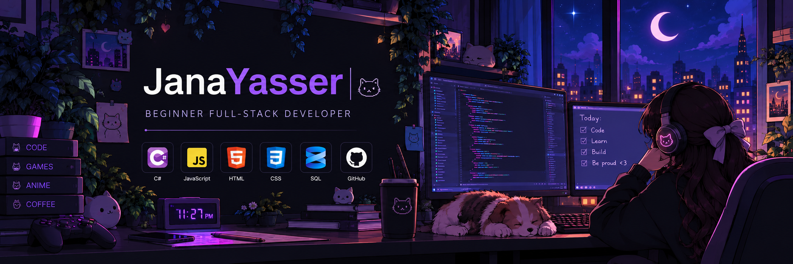

  

<h2 align="center">✨About Me</h2>
- I'm a self-taught developer and aspiring full-stack developer who loves turning ideas into real projects and learning something new every day.  
- I enjoy building practical applications, improving my problem-solving skills, and continuously expanding my knowledge through hands-on projects. Every project teaches me something new, and every challenge helps me grow as a developer.   

<h2 align="center">🛠️ Tech Stack</h2>

### 💻 Languages & Web

  

### ⚛️ Frameworks & Libraries

  

### 🗄️ Databases

  

### ⚙️ Tools & DevOps

  

### 🎨 Design & Creative

  
  

 

<h2 align="center">💻 Featured Projects</h2>

  A glimpse into what I've been working on.

<table>
  <tr>
    <td width="50%" valign="top">
      <h3>🏦 Bank Management System</h3>
      
A C# console application for basic banking operations, including account creation, deposits, withdrawals, transfers, balance checks, and account deletion.

      

        
        
      

      <a href="YOUR_BANK_MANAGEMENT_REPO_URL">↗ View Repository</a>
    </td>
    <td width="50%" valign="top">
      <h3>🎓 Student Management System</h3>
      
A C# console project built to practise application development and student record management.

      

        
        
      

      <a href="YOUR_STUDENT_MANAGEMENT_REPO_URL">↗ View Repository</a>
    </td>
  </tr>
  <tr>
    <td width="50%" valign="top">
      <h3>🎵 Music Player</h3>
      
A frontend music player project built with HTML, CSS, and JavaScript.

      

        
        
        
      

      <a href="YOUR_MUSIC_PLAYER_REPO_URL">↗ View Repository</a>
    </td>
    <td width="50%" valign="top">
      <h3>🚚 FleetOps</h3>
      
A fleet-management project currently in progress.

      

        
      

      <em>More details coming soon.</em>
    </td>
  </tr>
</table>

 
<h2 align="center">💼 Experience</h2>

<h3>📚 Training & Experience</h3>

- **DEPI — Full Stack .NET Training** · In Progress
  - Developing skills in full-stack development with .NET.

- **ITI — Introduction to Web Technologies** · July–August 2025
  - Completed 60 hours of training in HTML, CSS, JavaScript, HTML5, and CSS3.

- **QNB Egypt — Summer Training Program** · August 2026
  - Completed training through the Head Office Information Technology Division.

 
<h2 align="center">🌱 Currently Learning</h2>

  Expanding my skills across the .NET ecosystem and modern web development.

<table align="center">
  <tr>
    <td align="center" width="180">
      
        
      <strong>Advanced C#</strong>
    </td>
    <td align="center" width="180">
      
        
      <strong>ASP.NET Core MVC</strong>
    </td>
    <td align="center" width="180">
      
        
      <strong>Web API</strong>
    </td>
  </tr>
  <tr>
    <td align="center" width="180">
      
        
      <strong>Entity Framework Core</strong>
    </td>
    <td align="center" width="180">
      
        
      <strong>Angular</strong>
    </td>
    <td align="center" width="180">
      
        
      <strong>Docker</strong>
    </td>
  </tr>
</table>

 
<h2 align="center">📊 GitHub Statistics</h2>

  
  

  

 
<h2 align="center">🌙 Random Dev Quote</h2>

  

 
<h2 align="center">💌 Connect With Me</h2>

  
  
  

